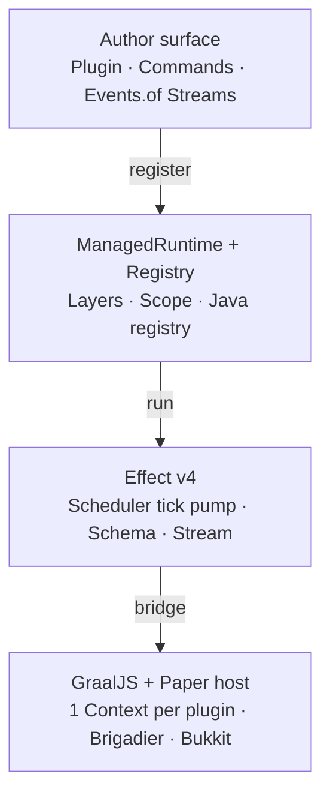

# Architecture

## Stack



## Packages

| Package | Role |
| --- | --- |
| `effectmc-host` | Java Paper plugin. Owns the Graal Engine, the tick pump, and the Registry |
| `@effectmc/paper-types` | Generated Paper typings plus patch overlays |
| `@effectmc/core` | `Plugin()`, `ManagedRuntime`, `Events.of` / `SyncWindow`, `Paper.on` / `Paper.offload`, errors |
| `@effectmc/commands` | Author surface inspired by effect/cli. Compiles `Command` to Brigadier and stays thin on Paper |
| `@effectmc/test` | Mock server Layer plus fake events and senders. Ships early |
| `@effectmc/ui` | Deferred: TEA plus `InventoryBuilder` |
| `@effectmc/luckperms` | Deferred: optional LuckPerms adapter Layer |

## GraalJS host (v0 engine)

- The host embeds `js-community`, with one Context per plugin on a shared Engine.
- Graal loads through the `paper-plugin.yml` `PluginLoader`. **Don't shade or relocate Graal.** One host plugin owns Graal for the whole server.
- Javet is deferred, because a second runtime would double the surface.
- Measure interpreter-only mode against Truffle/JVMCI on a stock JDK early.
- `HostAccess` is an **allow-list** of Paper API packages. Never use `allowAll`, because JS must not reach other plugins through Java.

## Reload contract (caveated)

An explicit reload runs these steps in order:

1. Dispose the plugin's `ManagedRuntime`.
2. Unregister everything in the Java Registry: listeners, tasks, permissions, open GUIs.
3. `context.close()`.
4. Create a new Context.
5. Start the plugin program again.

The **shape** of the command tree is fixed at load time, because the Paper Lifecycle API requires it. Handlers can still be hot-swapped through a lookup table. If the shape changes, the host warns that a full `/reload` is needed.

Don't call this production-safe hot module reload until the 50× leak spike passes.

## Declarative entry

The entry point follows Alchemy's shape:

```typescript
EffectMC.Plugin(name, layers, program)
```

The program registers command, listener, and task values through the host Registry, so teardown is mechanical.
